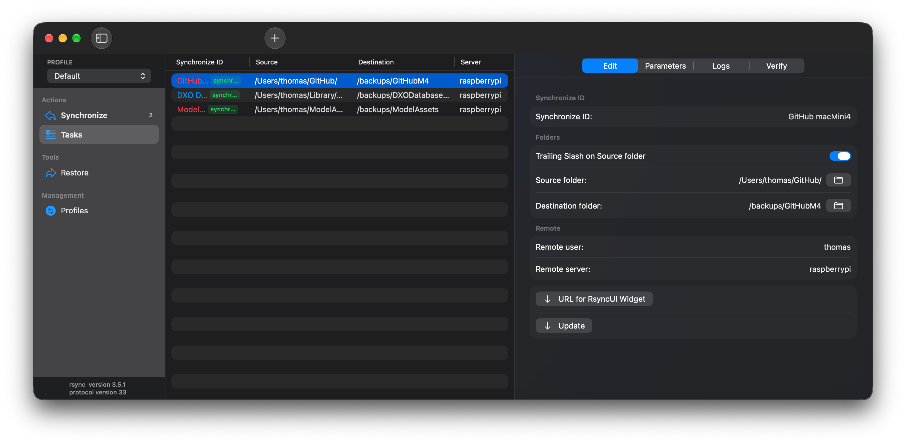

# RsyncUI
[](https://github.com/rsyncOSX/RsyncUI/blob/main/Licence.MD)


[](https://github.com/rsyncOSX/RsyncUI/issues)

RsyncUI is a SwiftUI macOS GUI for [rsync](https://github.com/WayneD/rsync) — it handles task organisation and parameter configuration so you can get the most out of rsync without touching the command line.

If RsyncUI is useful to you, a ⭐ on [the repository](https://github.com/rsyncOSX/RsyncUI) is always appreciated!

## RsyncUI 3.6.0

RsyncUI 3.6.0 brings the redesigned interface and the Shortcuts support that were tested as 4.0.0 in [RsyncUI-next](https://github.com/rsyncOSX/RsyncUI-next), together with several bug fixes. A detailed list of the changes is in [Docs/version360b218updates.md](Docs/version360b218updates.md).

### What's new

**A redesigned interface**

- **Synchronize and Tasks workspaces** rebuilt around the task table, with a persistent preview and run bar and the synchronization progress shown below the table.
- **A task inspector** for the selected task, with General, Rsync Options, Logs and Verify tabs.
- **Clearer task setup**: the task direction and its source and destination are summarised while you create or edit a task.
- **Safer runs**:
  - the run confirmation shows where data goes and which deletion options are in effect
  - a warning when deletion (`--delete`) is enabled
  - confirmation is required when a dry run cannot determine the changes
  - only estimated tasks are synchronized after an incomplete preview
- **Restore, Snapshots and Profiles** follow the same layout as the main workspace.
- **Languages**: Simplified Chinese (zh-Hans) and Traditional Chinese (zh-Hant) are updated for the new interface.

**Shortcuts, Siri and Spotlight**

RsyncUI can now be used from the Shortcuts app, Siri and Spotlight, without opening the RsyncUI window. RsyncUI quits by itself when the action is done.

| Action | What it does |
| --- | --- |
| **Estimate Tasks** | A dry run of a profile, or of selected tasks. Reports files to transfer, size and files to delete. Changes nothing, and works for every task. |
| **Synchronize Tasks** | Estimates first, then synchronizes the tasks that have changes, following each task's own `--delete` setting. Writes log records like a run in RsyncUI. |

Synchronize Tasks only runs tasks you have approved:

1. In RsyncUI, select the task and open the **Verify** tab.
2. Choose **Verify Task** and check the result.
3. Click **Not allowed in Shortcuts** in the toolbar. It turns into a green **Allowed in Shortcuts**, and the task gets a green checkmark in the task list.

Changing what the task does (source, destination, server, user, rsync or SSH options) removes the approval, so the task must be verified again. Renaming the task does not.

Before synchronizing, Synchronize Tasks also stops when:

- the source folder of a task with `--delete` is missing or empty, for example a disconnected drive
- **Confirm execute** is turned on in Settings and the estimate needs confirmation
- the estimate shows more deletions than the optional **Maximum Deletions** in the shortcut
- RsyncUI is already running a task

The actions, messages and Siri phrases are available in English, Simplified Chinese and Traditional Chinese. Example Siri phrases: *"Estimate Documents in RsyncUI"* and *"Synchronize Documents with RsyncUI"*, where Documents is a profile name.

**Bug fixes**

- With openrsync, saving tasks no longer deletes snapshot and remote pull tasks, which need rsync 3.x.
- An unreadable log records file is kept aside instead of being overwritten.
- A large logfile no longer marks a successful synchronization as failed.
- A failed rsync run is reported even when *Check for error in output* is off.
- Snapshots are tagged correctly around New Year.
- The command preview shows the real command, quoted so it can be pasted into Terminal.

### Before you update

- **Back up your settings.** RsyncUI keeps its tasks, logs and settings in `~/.rsyncosx`. Copy that folder first:
  ```bash
  cp -R ~/.rsyncosx ~/rsyncosx-backup
  ```
- **Check your global SSH settings.** In earlier versions, the global SSH port and key in **Settings → Ssh** were saved but never used. RsyncUI 3.6.0 fixes this: the global port and key now apply to every remote task that has no SSH port or key of its own. Rsync daemon tasks are not affected.
  - **Why this matters:** an old or wrong value in **Settings → Ssh** had no effect before, so it may have gone unnoticed. In 3.6.0 it is used, and tasks that relied on the default (port 22 and your default key) may fail to connect.
  - **Before your first run:** open **Settings → Ssh** and check the port and key. Correct them, or clear them if you don't want global defaults. Tasks that set their own SSH port or key keep using those.
- **Going back to 3.5.** Version 3.5 ignores the Shortcuts approvals and drops them if it saves the tasks, so they must be allowed again in 3.6.0. If anything else looks wrong after going back, restore your backup.

## Requirements

- macOS Sonoma or later

## Installation

Install via Homebrew:

```bash
brew install --cask rsyncui
```

Or download directly from the [releases page](https://github.com/rsyncOSX/RsyncUI/releases). The application is signed and notarized by Apple.

## Latest release

- v3.6.0 — in active development
- v3.5.0 — November 21, 2026 — current stable release

## Documentation

- [User documentation](https://rsyncui.netlify.app/docs/) (built on the Hugo-based [Docsy](https://github.com/google/docsy) theme)
- [Release notes](https://rsyncui.netlify.app/blog/)

## Swift packages

RsyncUI uses the following Swift Package Manager dependencies:

| Package | Function in RsyncUI |
| --- | --- |
| [DecodeEncodeGeneric](https://github.com/rsyncOSX/DecodeEncodeGeneric) | Encodes application data as JSON for persistent storage. |
| [ParseRsyncOutput](https://github.com/rsyncOSX/ParseRsyncOutput) | Parses rsync output into transfer statistics, including file counts, created and deleted files, and data sizes for estimates and execution results. |
| [ProcessCommand](https://github.com/rsyncOSX/ProcessCommand) | Runs supporting commands, such as SSH key creation, connection checks, and snapshot deletion, with output and termination handlers. |
| [RsyncArguments](https://github.com/rsyncOSX/RsyncArguments) | Builds rsync and SSH arguments for synchronization, dry runs, snapshots, restoration, verification, and remote file listings. |
| [RsyncProcessStreaming](https://github.com/rsyncOSX/RsyncProcessStreaming) | Executes rsync processes and streams their output to handlers for progress, errors, and completion. |
| [RsyncUIDeepLinks](https://github.com/rsyncOSX/RsyncUIDeepLinks) | Creates, parses, and validates deep-link URLs for profile actions and widget integration. |
| [SSHCreateKey](https://github.com/rsyncOSX/SSHCreateKey) | Prepares SSH key creation and connection arguments, manages key paths, and checks whether a public key exists. |


